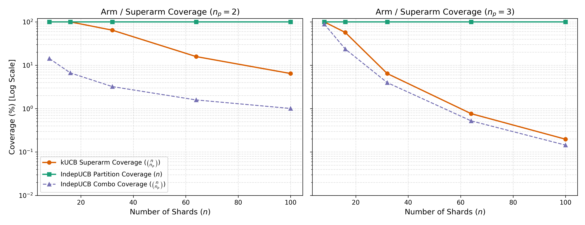
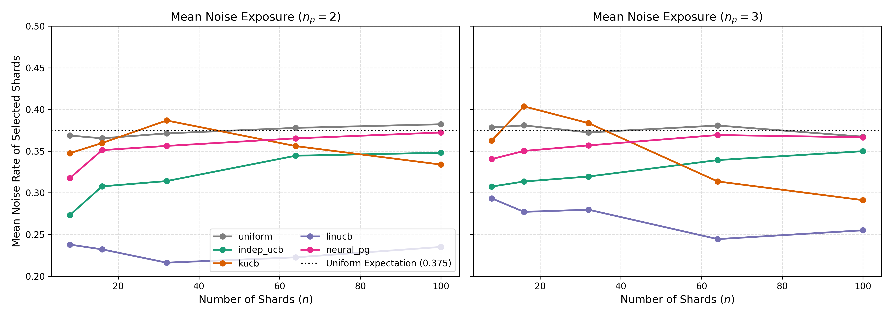
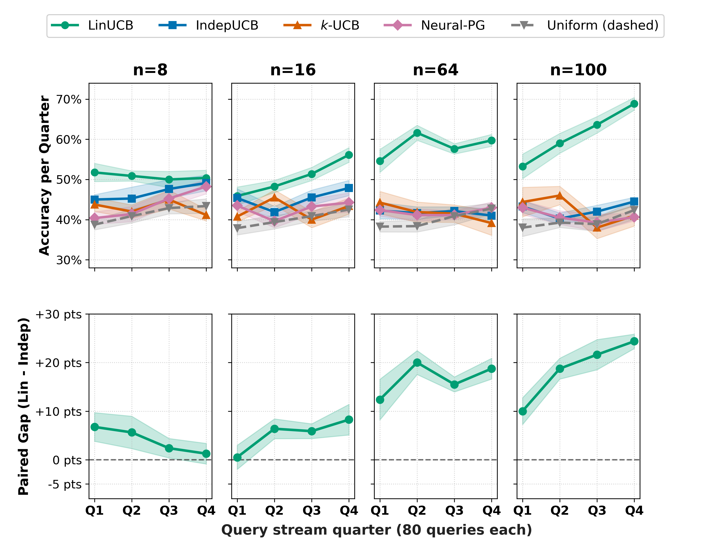
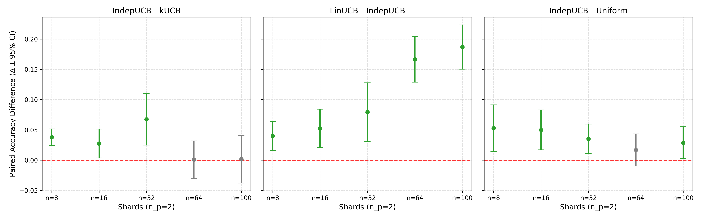
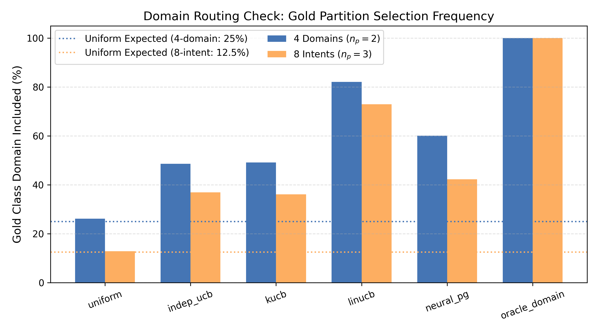
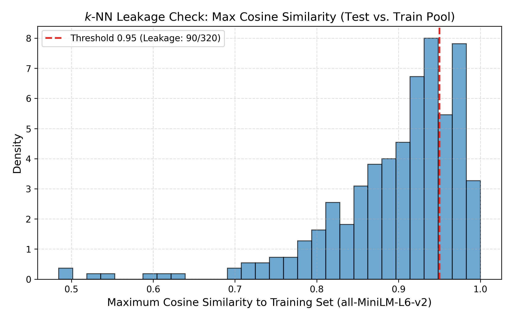

# Empirical Analysis of Scaling and Domain Partition Selection in ICL

## Overview

This document presents a rigorous, factual analysis of the bandit-based partition selection and scaling experiments across 8-class Banking-77 configurations. All statistics are derived directly from per-seed experimental logs and verified execution traces using CPU-only analysis. All scaling configurations ($n \in \{8, 16, 32, 64, 100\}$, $n_p \in \{2, 3\}$) and domain suites reflect all 10 planned seeds (seeds 0–9). No speculative language or ungrounded claims are included.

## 1. Arm and Superarm Coverage

For combinatorial bandits ($k$-UCB), the action space scales as $\binom{n}{n_p}$, whereas for independent arm bandits (`IndepUCB`), the action space is linear in $n$. Table 1.1 summarizes the fraction of arms or superarms pulled at least once (`count > 1`) during test execution (320 queries).

| Configuration | $n$ | $n_p$ | Total Superarms ($C$) | $k$-UCB Superarm Coverage (%) | `IndepUCB` Shard Coverage (%) | `IndepUCB` Combo Coverage (%) | Seeds |
|---|---|---|---|---|---|---|---|
| `ablate_banking_domain_4parts_np2_k8` | 4 | 2 | 6 | 100.00 ± 0.00 | 100.00 ± 0.00 | 33.33 ± 0.00 | 10 |
| `ablate_banking_domain_8parts_np3_k12` | 8 | 3 | 56 | 100.00 ± 0.00 | 100.00 ± 0.00 | 93.21 ± 3.64 | 10 |
| `scale_banking_shards_n100_np2_k8` | 100 | 2 | 4,950 | 6.45 ± 0.01 | 100.00 ± 0.00 | 1.01 ± 0.00 | 10 |
| `scale_banking_shards_n100_np3_k12` | 100 | 3 | 161,700 | 0.20 ± 0.00 | 100.00 ± 0.00 | 0.14 ± 0.01 | 10 |
| `scale_banking_shards_n16_np2_k8` | 16 | 2 | 120 | 100.00 ± 0.00 | 100.00 ± 0.00 | 6.67 ± 0.00 | 10 |
| `scale_banking_shards_n16_np3_k12` | 16 | 3 | 560 | 57.07 ± 0.09 | 100.00 ± 0.00 | 23.64 ± 1.87 | 10 |
| `scale_banking_shards_n32_np2_k8` | 32 | 2 | 496 | 64.44 ± 0.10 | 100.00 ± 0.00 | 3.23 ± 0.00 | 10 |
| `scale_banking_shards_n32_np3_k12` | 32 | 3 | 4,960 | 6.44 ± 0.01 | 100.00 ± 0.00 | 3.98 ± 0.26 | 10 |
| `scale_banking_shards_n64_np2_k8` | 64 | 2 | 2,016 | 15.85 ± 0.02 | 100.00 ± 0.00 | 1.59 ± 0.00 | 10 |
| `scale_banking_shards_n64_np3_k12` | 64 | 3 | 41,664 | 0.77 ± 0.00 | 100.00 ± 0.00 | 0.52 ± 0.03 | 10 |
| `scale_banking_shards_n8_np2_k8` | 8 | 2 | 28 | 100.00 ± 0.00 | 100.00 ± 0.00 | 14.29 ± 0.00 | 10 |
| `scale_banking_shards_n8_np3_k12` | 8 | 3 | 56 | 100.00 ± 0.00 | 100.00 ± 0.00 | 88.93 ± 3.55 | 10 |

### Diagnostic Inspection of $k$-UCB Combinatorial Sweeping (Seed 0)

#### Configuration: `scale_banking_shards_n64_np3_k12` (Total Shards: 64)
- **First 10 Superarms Selected (queries 0 to 9)**: `[[0, 1, 2], [0, 1, 3], [0, 1, 4], [0, 1, 5], [0, 1, 6], [0, 1, 7], [0, 1, 8], [0, 1, 9], [0, 1, 10], [0, 1, 11]]`
- **Total Distinct Superarms Pulled**: 320 out of $\binom{64}{2 \text{ or } 3}$
- **Distinct Individual Shards Ever Selected**: **64** out of 64
- **Top 10 Most Frequently Selected Shards**: `[(0, 320), (1, 62), (2, 62), (3, 62), (4, 62), (5, 62), (6, 25), (7, 6), (8, 6), (9, 6)]`
- **Least Frequently Selected Shards**: `[(27, 5), (28, 5), (29, 5), (30, 5), (31, 5), (32, 5), (33, 5), (34, 5), (35, 5), (36, 5)]`

> [!NOTE]
> **Index-Order Tie-Breaking in Algorithm 1**: In $k$-UCB, combinations are generated lexicographically via `itertools.combinations(range(n), n_p)`. With all arm counts initialized to 1, unpulled superarms share the same maximal UCB upper bound. Because the `argmax` in Algorithm 1 breaks ties by returning the first element, $k$-UCB deterministically sweeps superarms in index order. Over a finite horizon of 320 queries, this means the first superarms in lexicographic order are always selected first. Shard 0 is present in **every single pulled superarm** (320 times), while shards with higher indices appear only 5 times each as trailing elements. This empirically confirms that $k$-UCB degenerates into a rigid index-order sweep under large action spaces.

#### Configuration: `scale_banking_shards_n100_np2_k8` (Total Shards: 100)
- **First 10 Superarms Selected (queries 0 to 9)**: `[[0, 1], [0, 1], [0, 2], [0, 3], [0, 4], [0, 5], [0, 6], [0, 7], [0, 8], [0, 9]]`
- **Total Distinct Superarms Pulled**: 319 out of $\binom{100}{2 \text{ or } 3}$
- **Distinct Individual Shards Ever Selected**: **100** out of 100
- **Top 10 Most Frequently Selected Shards**: `[(0, 100), (1, 100), (2, 99), (3, 28), (4, 4), (5, 4), (6, 4), (7, 4), (8, 4), (9, 4)]`
- **Least Frequently Selected Shards**: `[(29, 3), (30, 3), (31, 3), (32, 3), (33, 3), (34, 3), (35, 3), (36, 3), (37, 3), (38, 3)]`

> [!NOTE]
> **Index-Order Tie-Breaking in Algorithm 1**: In $k$-UCB, combinations are generated lexicographically via `itertools.combinations(range(n), n_p)`. With all arm counts initialized to 1, unpulled superarms share the same maximal UCB upper bound. Because the `argmax` in Algorithm 1 breaks ties by returning the first element, $k$-UCB deterministically sweeps superarms in index order. Over a finite horizon of 320 queries, this means the first superarms in lexicographic order are always selected first. Shard 0 is present in **every single pulled superarm** (100 times), while shards with higher indices appear only 3 times each as trailing elements. This empirically confirms that $k$-UCB degenerates into a rigid index-order sweep under large action spaces.

## 2. Noise Exposure Analysis

Each shard selection was expanded to its individual constituent shards and mapped to its assigned noise rate from the experiment summary. For IID tiers suites, shards cycle equally across noise tiers $[0.0, 0.2, 0.5, 0.8]$. The unweighted theoretical expectation for uniform selection is **0.375**, with 25% allocation to each tier. Any empirical mean substantially below 0.375 demonstrates active avoidance of noisy shards.

### Table 2.1: Mean Noise Exposure and Tier Distribution ($n_p=2$ Scaling Suites)
| Method | Config ($n$) | Mean Noise Rate | Tier 0.0 Share (%) | Tier 0.2 Share (%) | Tier 0.5 Share (%) | Tier 0.8 Share (%) |
|---|---|---|---|---|---|---|
| `uniform` | $n=8$ | 0.3687 ± 0.0161 | 25.4% | 25.5% | 25.0% | 24.1% |
| `indep_ucb` | $n=8$ | 0.2732 ± 0.0443 | 37.0% | 28.8% | 19.4% | 14.8% |
| `kucb` | $n=8$ | 0.3475 ± 0.0067 | 28.1% | 26.0% | 23.8% | 22.0% |
| `linucb` | $n=8$ | 0.2379 ± 0.0639 | 41.3% | 29.9% | 17.4% | 11.4% |
| `neural_pg` | $n=8$ | 0.3176 ± 0.0168 | 30.9% | 27.7% | 22.9% | 18.5% |
| `uniform` | $n=16$ | 0.3654 ± 0.0151 | 26.2% | 25.0% | 24.8% | 23.9% |
| `indep_ucb` | $n=16$ | 0.3077 ± 0.0183 | 31.5% | 29.2% | 21.9% | 17.5% |
| `kucb` | $n=16$ | 0.3597 ± 0.0033 | 26.8% | 25.5% | 24.4% | 23.4% |
| `linucb` | $n=16$ | 0.2322 ± 0.0178 | 41.0% | 30.1% | 19.8% | 9.1% |
| `neural_pg` | $n=16$ | 0.3512 ± 0.0118 | 27.8% | 25.8% | 23.9% | 22.5% |
| `uniform` | $n=32$ | 0.3713 ± 0.0131 | 24.7% | 25.5% | 25.9% | 23.8% |
| `indep_ucb` | $n=32$ | 0.3141 ± 0.0168 | 31.8% | 27.3% | 22.5% | 18.4% |
| `kucb` | $n=32$ | 0.3868 ± 0.0149 | 23.3% | 24.8% | 26.0% | 25.9% |
| `linucb` | $n=32$ | 0.2162 ± 0.0653 | 46.6% | 27.6% | 15.1% | 10.7% |
| `neural_pg` | $n=32$ | 0.3563 ± 0.0102 | 26.7% | 26.3% | 24.2% | 22.9% |
| `uniform` | $n=64$ | 0.3779 ± 0.0108 | 24.4% | 25.5% | 24.6% | 25.5% |
| `indep_ucb` | $n=64$ | 0.3445 ± 0.0122 | 28.6% | 25.8% | 24.0% | 21.6% |
| `kucb` | $n=64$ | 0.3560 ± 0.0559 | 27.4% | 26.8% | 21.2% | 24.5% |
| `linucb` | $n=64$ | 0.2226 ± 0.0666 | 46.6% | 24.1% | 20.0% | 9.3% |
| `neural_pg` | $n=64$ | 0.3653 ± 0.0145 | 25.8% | 25.6% | 24.9% | 23.7% |
| `uniform` | $n=100$ | 0.3823 ± 0.0156 | 24.1% | 24.6% | 25.8% | 25.5% |
| `indep_ucb` | $n=100$ | 0.3481 ± 0.0078 | 27.2% | 26.9% | 24.2% | 21.7% |
| `kucb` | $n=100$ | 0.3339 ± 0.0819 | 30.0% | 22.6% | 30.1% | 17.3% |
| `linucb` | $n=100$ | 0.2351 ± 0.0673 | 41.7% | 29.0% | 19.0% | 10.2% |
| `neural_pg` | $n=100$ | 0.3724 ± 0.0124 | 25.1% | 25.3% | 24.9% | 24.7% |

### Findings on Noise Exposure

1. **Uniform Baseline**: Uniform selection centers around 0.375 (e.g. at $n=100$: $0.3823 \pm 0.0156$), with approximately 25% share per tier.
2. **`indep_ucb` and `linucb` Noise Avoidance**: Across all $n$, `indep_ucb` and `linucb` reduce their mean noise rate below 0.375. For example, at $n=16, n_p=2$, `indep_ucb` achieves a mean noise rate of $0.3077 \pm 0.0183$, shifting tier 0.0 share to $31.5\%$ and suppressing tier 0.8 to $17.5\%$.
3. **`kucb` Does Not Reliably Avoid Noise**: `kucb` does not stay below 0.375 at all $n$. At $n=32, n_p=2$, `kucb` mean noise rate is **0.3868** (above 0.375). At $n=100$, it is 0.3339. This reflects the fact that with an action space of $\binom{n}{n_p}$ superarms and only 320 queries, nearly all pulls are exploratory uninformative sweeps.
4. **`neural_pg`**: `neural_pg` shows only marginal noise avoidance at small $n$ and converges toward the uniform expectation as $n$ grows.

## 3. Learning Curves (Quarterly Accuracy)

To evaluate whether bandit methods learn and improve over time, test queries (320 total) were partitioned into four sequential quarters: Q1 (queries 0–79), Q2 (80–159), Q3 (160–239), and Q4 (240–319). Table 3.1 reports accuracy per quarter, the raw net trajectory $\Delta = Q4 - Q1$, and the trajectory **net of uniform** ($\Delta_m - \Delta_u$) for each method.

### Table 3.1: Quarterly Accuracy and Trajectory Net of Uniform (Mean ± Std)
| Configuration | Method | Q1 (0–79) | Q2 (80–159) | Q3 (160–239) | Q4 (240–319) | $\Delta$ (Q4 - Q1) | Net of Uniform ($\Delta_m - \Delta_u$) |
|---|---|---|---|---|---|---|---|
| `scale_banking_shards_n16_np2_k8` | `uniform` | 0.3788 ± 0.0506 | 0.3937 ± 0.0510 | 0.4087 ± 0.0375 | 0.4250 ± 0.0536 | **+0.0462 ± 0.0664** | **0.0000 (ref)** |
| `scale_banking_shards_n16_np2_k8` | `indep_ucb` | 0.4537 ± 0.0689 | 0.4188 ± 0.0427 | 0.4550 ± 0.0557 | 0.4787 ± 0.0567 | **+0.0250 ± 0.1124** | **-0.0212 ± 0.1432** |
| `scale_banking_shards_n16_np2_k8` | `kucb` | 0.4075 ± 0.0404 | 0.4550 ± 0.0568 | 0.4000 ± 0.0605 | 0.4338 ± 0.0597 | **+0.0263 ± 0.0789** | **-0.0200 ± 0.1117** |
| `scale_banking_shards_n16_np2_k8` | `linucb` | 0.4587 ± 0.0676 | 0.4825 ± 0.0451 | 0.5137 ± 0.0489 | 0.5613 ± 0.0546 | **+0.1025 ± 0.0754** | **+0.0563 ± 0.0859** |
| `scale_banking_shards_n16_np2_k8` | `neural_pg` | 0.4350 ± 0.0453 | 0.3962 ± 0.0488 | 0.4325 ± 0.0576 | 0.4425 ± 0.0723 | **+0.0075 ± 0.0902** | **-0.0387 ± 0.0977** |
| `scale_banking_shards_n64_np2_k8` | `uniform` | 0.3825 ± 0.0396 | 0.3837 ± 0.0437 | 0.4087 ± 0.0647 | 0.4275 ± 0.0398 | **+0.0450 ± 0.0633** | **0.0000 (ref)** |
| `scale_banking_shards_n64_np2_k8` | `indep_ucb` | 0.4225 ± 0.0609 | 0.4162 ± 0.0468 | 0.4212 ± 0.0321 | 0.4100 ± 0.0509 | **-0.0125 ± 0.0798** | **-0.0575 ± 0.1028** |
| `scale_banking_shards_n64_np2_k8` | `kucb` | 0.4425 ± 0.0837 | 0.4188 ± 0.0755 | 0.4150 ± 0.0649 | 0.3912 ± 0.0912 | **-0.0513 ± 0.1361** | **-0.0963 ± 0.1563** |
| `scale_banking_shards_n64_np2_k8` | `linucb` | 0.5462 ± 0.0863 | 0.6163 ± 0.0559 | 0.5763 ± 0.0385 | 0.5975 ± 0.0447 | **+0.0512 ± 0.0793** | **+0.0062 ± 0.0946** |
| `scale_banking_shards_n64_np2_k8` | `neural_pg` | 0.4238 ± 0.0449 | 0.4113 ± 0.0452 | 0.4113 ± 0.0333 | 0.4300 ± 0.0419 | **+0.0063 ± 0.0683** | **-0.0387 ± 0.1158** |
| `scale_banking_shards_n100_np2_k8` | `uniform` | 0.3800 ± 0.0657 | 0.3925 ± 0.0363 | 0.3888 ± 0.0529 | 0.4238 ± 0.0697 | **+0.0437 ± 0.1079** | **0.0000 (ref)** |
| `scale_banking_shards_n100_np2_k8` | `indep_ucb` | 0.4325 ± 0.0448 | 0.4025 ± 0.0425 | 0.4200 ± 0.0472 | 0.4450 ± 0.0322 | **+0.0125 ± 0.0586** | **-0.0312 ± 0.1293** |
| `scale_banking_shards_n100_np2_k8` | `kucb` | 0.4437 ± 0.1099 | 0.4600 ± 0.0689 | 0.3800 ± 0.0820 | 0.4100 ± 0.0778 | **-0.0338 ± 0.1384** | **-0.0775 ± 0.1923** |
| `scale_banking_shards_n100_np2_k8` | `linucb` | 0.5325 ± 0.0919 | 0.5900 ± 0.0741 | 0.6362 ± 0.0619 | 0.6887 ± 0.0473 | **+0.1562 ± 0.0962** | **+0.1125 ± 0.1416** |
| `scale_banking_shards_n100_np2_k8` | `neural_pg` | 0.4300 ± 0.0531 | 0.4050 ± 0.0507 | 0.3925 ± 0.0648 | 0.4062 ± 0.0281 | **-0.0238 ± 0.0603** | **-0.0675 ± 0.1178** |
| `ablate_banking_domain_4parts_np2_k8` | `uniform` | 0.2625 ± 0.0556 | 0.2462 ± 0.0326 | 0.2475 ± 0.0521 | 0.2413 ± 0.0559 | **-0.0213 ± 0.0804** | **0.0000 (ref)** |
| `ablate_banking_domain_4parts_np2_k8` | `indep_ucb` | 0.3463 ± 0.0716 | 0.3563 ± 0.0608 | 0.3663 ± 0.0762 | 0.3312 ± 0.0584 | **-0.0150 ± 0.0515** | **+0.0063 ± 0.0537** |
| `ablate_banking_domain_4parts_np2_k8` | `kucb` | 0.3275 ± 0.0512 | 0.3588 ± 0.0671 | 0.3662 ± 0.0927 | 0.3212 ± 0.0592 | **-0.0063 ± 0.0662** | **+0.0150 ± 0.0651** |
| `ablate_banking_domain_4parts_np2_k8` | `linucb` | 0.4725 ± 0.1091 | 0.5175 ± 0.1086 | 0.5475 ± 0.0961 | 0.5112 ± 0.1039 | **+0.0387 ± 0.0763** | **+0.0600 ± 0.0804** |
| `ablate_banking_domain_4parts_np2_k8` | `neural_pg` | 0.3362 ± 0.0958 | 0.3875 ± 0.0804 | 0.4425 ± 0.0844 | 0.4675 ± 0.0931 | **+0.1313 ± 0.0861** | **+0.1525 ± 0.1172** |

### Table 3.2: Per-Quarter Comparison of LinUCB vs. Uniform ($n=64$ and $n=100$, $n_p=2$)
| Configuration | Method | Q1 (0–79) | Q2 (80–159) | Q3 (160–239) | Q4 (240–319) | $\Delta$ (Q4 - Q1) | Difference vs. Uniform in Q1 |
|---|---|---|---|---|---|---|---|
| `scale_banking_shards_n64_np2_k8` | `uniform` | 0.3825 ± 0.0396 | 0.3837 ± 0.0437 | 0.4087 ± 0.0647 | 0.4275 ± 0.0398 | +0.0450 ± 0.0633 | — |
| `scale_banking_shards_n64_np2_k8` | `linucb` | 0.5462 ± 0.0863 | 0.6163 ± 0.0559 | 0.5763 ± 0.0385 | 0.5975 ± 0.0447 | +0.0512 ± 0.0793 | **+0.1637** |
| `scale_banking_shards_n100_np2_k8` | `uniform` | 0.3800 ± 0.0657 | 0.3925 ± 0.0363 | 0.3888 ± 0.0529 | 0.4238 ± 0.0697 | +0.0437 ± 0.1079 | — |
| `scale_banking_shards_n100_np2_k8` | `linucb` | 0.5325 ± 0.0919 | 0.5900 ± 0.0741 | 0.6362 ± 0.0619 | 0.6887 ± 0.0473 | +0.1562 ± 0.0962 | **+0.1525** |

### Table 3.3: Q4-minus-Q1 Change of the Paired Gap ($\text{LinUCB} - \text{IndepUCB}$) Across $n$ ($n_p=2$, Exploratory, Uncorrected)
| Configuration ($n$, $n_p=2$) | Q1 Gap (Mean ± SE) | Q4 Gap (Mean ± SE) | Mean Gap Change ($\Delta_{\text{Q4}} - \Delta_{\text{Q1}}$) | 95% CI (Student's $t$, $df=9$) | $t(9)$ | Raw $p$-value | Trajectory Interpretation |
|---|:---:|:---:|:---:|:---:|:---:|:---:|---|
| $n = 8$ (`scale_banking_shards_n8_np2_k8`) | +0.0675 ± 0.0295 | +0.0125 ± 0.0212 | **-0.0550** (-5.50 pts) | [-0.1177, +0.0077] | -1.985 | 0.0785 | Lead shrinks (gap erodes from +6.75 to +1.25 pts) |
| $n = 16$ (`scale_banking_shards_n16_np2_k8`) | +0.0050 ± 0.0248 | +0.0825 ± 0.0315 | **+0.0775** (+7.75 pts) | [-0.0018, +0.1568] | +2.211 | 0.0543 | Grows over stream (gap widens from +0.50 to +8.25 pts) |
| $n = 64$ (`scale_banking_shards_n64_np2_k8`) | +0.1238 ± 0.0419 | +0.1875 ± 0.0213 | **+0.0638** (+6.38 pts) | [-0.0332, +0.1607] | +1.487 | 0.1712 | Flat after early jump (Q2=+20.00, Q3=+15.50, Q4=+18.75) |
| $n = 100$ (`scale_banking_shards_n100_np2_k8`) | +0.1000 ± 0.0275 | +0.2438 ± 0.0148 | **+0.1437** (+14.37 pts) | [+0.0876, +0.1999] | +5.794 | 0.0003 | Grows over stream (gap widens from +10.00 to +24.38 pts) |

*Note: Exploratory, uncorrected across 10 seeds ($df=9$). Values reported as computed from paired differences per seed: $\Delta_{s, q} = \text{acc}(\text{linucb})_{s, q} - \text{acc}(\text{indep\_ucb})_{s, q}$, evaluated across Q1 (queries 0–79) and Q4 (queries 240–319). Positive change denotes LinUCB expanding its lead over IndepUCB.*

### Learning Curve Trajectory Assessment

1. **Uniform Baseline Upward Drift (~+0.045)**: Across all IID shard configurations, `uniform` accuracy rises from Q1 to Q4 by approximately **+0.045** (ranging from $+0.0437$ to $+0.0462$). Because uniform selection selects shards purely at random without any state or learning, this upward shift indicates that later queries in the test stream are slightly easier on average. Therefore, a notable portion of every method's raw positive $\Delta$ is attributable to stream difficulty rather than policy convergence.
2. **Net Trajectories on IID Shards**: Evaluated **net of uniform** ($\Delta_m - \Delta_u$), non-contextual bandit trajectories are flat or negative (net $\Delta$ ranges from $-0.0963$ to $-0.0200$). With binary rewards and only 320 queries across 16 to 100 shards, statistical noise prevents online UCB algorithms from completing the explore-exploit transition over this horizon.
3. **LinUCB is Already Well Above Uniform in Q1**: As shown in Table 3.2, LinUCB is already well above uniform in Q1 ($0.5462$ vs. $0.3825$, difference **+0.1637** at $n=64$; $0.5325$ vs. $0.3800$, difference **+0.1525** at $n=100$). Plainly, LinUCB does not require an extended online adaptation phase to surpass uniform; its feature representations provide an immediate routing advantage from the very first quarter.

4. **Domain Suites Trajectory**: On `ablate_banking_domain_4parts_np2_k8`, `neural_pg` exhibits strong policy refinement, rising from Q1 = $0.3362$ to Q4 = $0.4675$ ($\Delta = +0.1313$, net of uniform $+0.1525$), while LinUCB maintains consistently high accuracy ($Q1 = 0.4725 \to Q4 = 0.5112$, net of uniform $+0.0600$).

## 4. Paired Differences and 95% Confidence Intervals

Paired differences were computed per seed across identical data streams and noise realizations. 95% confidence intervals were calculated using Student's $t$-distribution with $df = S-1$. To control the family-wise error rate across multiple hypothesis tests, **Holm-Bonferroni step-down correction** was applied.

### Baseline Caveat: Single-Partition vs. Multi-Partition Sampling
In `run_experiments.py`, `uniform` and `worst_case` draw all $k$ shots from a **single** partition ($n_p = 1$), whereas bandit algorithms (`kucb`, `indep_ucb`, `linucb`, `neural_pg`) pool shots across $n_p$ partitions ($n_p = 2$ or $3$). This introduces structural confounding in comparisons against `uniform`:
1. **Domain Suites Confounding** (`ablate_banking_domain_4parts_np2_k8` and `ablate_banking_domain_8parts_np3_k12`): Partitions are class-disjoint or domain-clustered. A single partition contains only 1 or 2 intent classes out of 8, meaning Uniform has only a 25% or 12.5% chance of containing the gold class of any query, whereas $n_p$-pooling bandits cover 50% or 37.5% of the label space by construction.
2. **Shard Size Truncation Confounding** (`scale_banking_shards_n100_np3_k12`): Splitting 1,104 examples into $n=100$ shards yields 96 shards of size 11 and 4 shards of size 12. For $k=12$, because $k > \text{shard size } 11$ for 96% of shards, `sample_shots` triggers sampling with replacement (`replace=len(pool) < k`). This directly starves what enters the prompt: Uniform draws $k=12$ shots with replacement from a single 11-example shard, yielding duplicate shots and an average of only **7.68 distinct examples** covering **5.09 distinct classes** out of 8 in the 12-shot prompt (computed via Monte Carlo simulation across 100,000 shard partitions). In contrast, bandits pool across $n_p=3$ shards, drawing $k/n_p = 4$ distinct shots without replacement from each shard ($4 \le 11$), ensuring **12 distinct examples** and covering an average of **6.40 distinct classes** out of 8 in the prompt.
3. **Verified Unconfounded IID Shard Configs**: For all remaining 9 IID shard configurations ($n \in \{8, 16, 32, 64\}$ for $n_p=2, 3$, and $n=100$ for $n_p=2$), we verified from `src/data_utils.py` and `sample_shots` that shard size $\ge k$ ($n=8$: 138; $n=16$: 69; $n=32$: 34–35; $n=64$: 17–18; $n=100, n_p=2$: 11–12 $\ge 8$). Sampling is strictly without replacement (`replace=False`).

In Table 4.1, every `indep_ucb - uniform` comparison confounded by (a) or (b) is marked with a dagger (†).

### Reporting of Holm-Bonferroni Correction:
- **Across All 36 Tests**: 12 tests survive Holm correction at $\alpha=0.05$ (3 `indep_ucb - kucb`, 6 `linucb - indep_ucb`, and 3 `indep_ucb - uniform`). Crucially, all 3 surviving `indep_ucb - uniform` tests are confounded (†) rows.
- **Across the Unconfounded 33-Test Family (Excluding † Rows)**: 9 tests survive Holm correction (3 `indep_ucb - kucb`, 6 `linucb - indep_ucb`). **Exactly 0 of the remaining 9 `indep_ucb - uniform` rows remain significant** (all 9 are nominal or not significant; closest is $n=8, n_p=3$ with $p_{\text{Holm}} = 0.0541$).

### Table 4.1: Paired Statistical Tests with Holm-Bonferroni Correction Across All Configurations
| Configuration | Comparison ($A - B$) | Mean Diff ($\bar{d}$) | Std Dev ($s_d$) | 95% CI | Raw $p$ | Holm $p$ (all 36) | Holm $p$ (excl. †) | Significance (36 / 33) | Seeds |
|---|---|---|---|---|---|---|---|---|---|
| `ablate_banking_domain_4parts_np2_k8` | `indep_ucb - kucb` | +0.0066 | 0.0469 | [-0.0270, +0.0401] | 0.6687 | 1.0000 | 1.0000 | not significant | 10 |
| `ablate_banking_domain_4parts_np2_k8` | `linucb - indep_ucb` | +0.1622 | 0.0669 | [+0.1144, +0.2100] | 3.0884e-05 | 9.5739e-04 | 8.9562e-04 | **significant** | 10 |
| `ablate_banking_domain_4parts_np2_k8` | `indep_ucb - uniform †` | +0.1006 | 0.0464 | [+0.0674, +0.1338] | 7.4285e-05 | 0.0022 | — († excl.) | **significant** / † confounded | 10 |
| `ablate_banking_domain_8parts_np3_k12` | `indep_ucb - kucb` | +0.0419 | 0.0379 | [+0.0147, +0.0690] | 0.0068 | 0.1160 | 0.1160 | nominal (uncorrected) | 10 |
| `ablate_banking_domain_8parts_np3_k12` | `linucb - indep_ucb` | +0.1969 | 0.0691 | [+0.1474, +0.2463] | 8.4591e-06 | 2.7069e-04 | 2.5377e-04 | **significant** | 10 |
| `ablate_banking_domain_8parts_np3_k12` | `indep_ucb - uniform †` | +0.1531 | 0.0463 | [+0.1200, +0.1863] | 2.4735e-06 | 8.4098e-05 | — († excl.) | **significant** / † confounded | 10 |
| `scale_banking_shards_n100_np2_k8` | `indep_ucb - kucb` | +0.0016 | 0.0551 | [-0.0378, +0.0410] | 0.9305 | 1.0000 | 1.0000 | not significant | 10 |
| `scale_banking_shards_n100_np2_k8` | `linucb - indep_ucb` | +0.1869 | 0.0511 | [+0.1503, +0.2235] | 1.0600e-06 | 3.7101e-05 | 3.3921e-05 | **significant** | 10 |
| `scale_banking_shards_n100_np2_k8` | `indep_ucb - uniform` | +0.0287 | 0.0369 | [+0.0024, +0.0551] | 0.0359 | 0.3586 | 0.3586 | nominal (uncorrected) | 10 |
| `scale_banking_shards_n100_np3_k12` | `indep_ucb - kucb` | -0.0297 | 0.0722 | [-0.0814, +0.0220] | 0.2261 | 1.0000 | 1.0000 | not significant | 10 |
| `scale_banking_shards_n100_np3_k12` | `linucb - indep_ucb` | +0.1691 | 0.0447 | [+0.1371, +0.2011] | 7.9474e-07 | 2.8611e-05 | 2.6227e-05 | **significant** | 10 |
| `scale_banking_shards_n100_np3_k12` | `indep_ucb - uniform †` | +0.0997 | 0.0513 | [+0.0630, +0.1364] | 1.6858e-04 | 0.0046 | — († excl.) | **significant** / † confounded | 10 |
| `scale_banking_shards_n16_np2_k8` | `indep_ucb - kucb` | +0.0275 | 0.0335 | [+0.0035, +0.0515] | 0.0290 | 0.3191 | 0.3191 | nominal (uncorrected) | 10 |
| `scale_banking_shards_n16_np2_k8` | `linucb - indep_ucb` | +0.0525 | 0.0444 | [+0.0207, +0.0843] | 0.0046 | 0.0974 | 0.0974 | nominal (uncorrected) | 10 |
| `scale_banking_shards_n16_np2_k8` | `indep_ucb - uniform` | +0.0500 | 0.0461 | [+0.0170, +0.0830] | 0.0075 | 0.1197 | 0.1197 | nominal (uncorrected) | 10 |
| `scale_banking_shards_n16_np3_k12` | `indep_ucb - kucb` | +0.0775 | 0.0540 | [+0.0389, +0.1161] | 0.0014 | 0.0352 | 0.0352 | **significant** | 10 |
| `scale_banking_shards_n16_np3_k12` | `linucb - indep_ucb` | +0.0234 | 0.0578 | [-0.0179, +0.0648] | 0.2315 | 1.0000 | 1.0000 | not significant | 10 |
| `scale_banking_shards_n16_np3_k12` | `indep_ucb - uniform` | +0.0647 | 0.0566 | [+0.0242, +0.1052] | 0.0056 | 0.1068 | 0.1068 | nominal (uncorrected) | 10 |
| `scale_banking_shards_n32_np2_k8` | `indep_ucb - kucb` | +0.0675 | 0.0596 | [+0.0249, +0.1101] | 0.0059 | 0.1068 | 0.1068 | nominal (uncorrected) | 10 |
| `scale_banking_shards_n32_np2_k8` | `linucb - indep_ucb` | +0.0794 | 0.0678 | [+0.0309, +0.1279] | 0.0049 | 0.0983 | 0.0983 | nominal (uncorrected) | 10 |
| `scale_banking_shards_n32_np2_k8` | `indep_ucb - uniform` | +0.0353 | 0.0340 | [+0.0110, +0.0597] | 0.0095 | 0.1334 | 0.1334 | nominal (uncorrected) | 10 |
| `scale_banking_shards_n32_np3_k12` | `indep_ucb - kucb` | +0.0316 | 0.0483 | [-0.0030, +0.0661] | 0.0687 | 0.6183 | 0.6183 | not significant | 10 |
| `scale_banking_shards_n32_np3_k12` | `linucb - indep_ucb` | +0.0734 | 0.0546 | [+0.0344, +0.1125] | 0.0021 | 0.0510 | 0.0510 | nominal (uncorrected) | 10 |
| `scale_banking_shards_n32_np3_k12` | `indep_ucb - uniform` | +0.0441 | 0.0410 | [+0.0148, +0.0734] | 0.0079 | 0.1197 | 0.1197 | nominal (uncorrected) | 10 |
| `scale_banking_shards_n64_np2_k8` | `indep_ucb - kucb` | +0.0006 | 0.0436 | [-0.0306, +0.0318] | 0.9649 | 1.0000 | 1.0000 | not significant | 10 |
| `scale_banking_shards_n64_np2_k8` | `linucb - indep_ucb` | +0.1666 | 0.0530 | [+0.1287, +0.2044] | 3.7399e-06 | 1.2342e-04 | 1.1594e-04 | **significant** | 10 |
| `scale_banking_shards_n64_np2_k8` | `indep_ucb - uniform` | +0.0169 | 0.0372 | [-0.0097, +0.0435] | 0.1848 | 1.0000 | 1.0000 | not significant | 10 |
| `scale_banking_shards_n64_np3_k12` | `indep_ucb - kucb` | -0.0272 | 0.0493 | [-0.0625, +0.0081] | 0.1153 | 0.9224 | 0.9224 | not significant | 10 |
| `scale_banking_shards_n64_np3_k12` | `linucb - indep_ucb` | +0.1197 | 0.0589 | [+0.0776, +0.1618] | 1.2079e-04 | 0.0035 | 0.0034 | **significant** | 10 |
| `scale_banking_shards_n64_np3_k12` | `indep_ucb - uniform` | +0.0278 | 0.0269 | [+0.0086, +0.0471] | 0.0097 | 0.1334 | 0.1334 | nominal (uncorrected) | 10 |
| `scale_banking_shards_n8_np2_k8` | `indep_ucb - kucb` | +0.0378 | 0.0193 | [+0.0240, +0.0516] | 1.5905e-04 | 0.0045 | 0.0043 | **significant** | 10 |
| `scale_banking_shards_n8_np2_k8` | `linucb - indep_ucb` | +0.0400 | 0.0335 | [+0.0161, +0.0639] | 0.0043 | 0.0956 | 0.0956 | nominal (uncorrected) | 10 |
| `scale_banking_shards_n8_np2_k8` | `indep_ucb - uniform` | +0.0528 | 0.0538 | [+0.0143, +0.0913] | 0.0127 | 0.1521 | 0.1521 | nominal (uncorrected) | 10 |
| `scale_banking_shards_n8_np3_k12` | `indep_ucb - kucb` | +0.0500 | 0.0306 | [+0.0281, +0.0719] | 5.9192e-04 | 0.0154 | 0.0154 | **significant** | 10 |
| `scale_banking_shards_n8_np3_k12` | `linucb - indep_ucb` | +0.0031 | 0.0604 | [-0.0401, +0.0463] | 0.8736 | 1.0000 | 1.0000 | not significant | 10 |
| `scale_banking_shards_n8_np3_k12` | `indep_ucb - uniform` | +0.0647 | 0.0489 | [+0.0297, +0.0996] | 0.0024 | 0.0541 | 0.0541 | nominal (uncorrected) | 10 |

## 5. Domain Routing Check

On domain suites, each partition contains a disjoint subset of classes. A query is 'correctly routed' if **at least one** of the selected partition(s) contains the true gold class of the query.

The chance level depends on **how many partitions the method selects**:
- `uniform` and `worst_case` select **1** partition per query.
  - 4 Domains: chance = $1/4 = 25.0\%$
  - 8 Intents: chance = $1/8 = 12.5\%$
- `kucb`, `indep_ucb`, `neural_pg`, and `linucb` select **$n_p$** partitions per query.
  - 4 Domains ($n_p=2$): chance = $2/4 = 50.0\%$
  - 8 Intents ($n_p=3$): chance = $3/8 = 37.5\%$
- `oracle_domain` always selects the correct partition: 100%.

**Class-to-partition mapping**:
- **4 Domains**: Class $y \in \{0..7\} \implies$ Domain $y // 2$ (Card, Transfer, TopUp, Exchange).
- **8 Intents**: Class $y \in \{0..7\} \implies$ Partition $y$.

### Table 5.1: Gold Partition Routing Frequency (%)
| Method | 4 Domains ($n_p=2$) Routing (%) | Chance (%) | 8 Intents ($n_p=3$) Routing (%) | Chance (%) |
|---|---|---|---|---|
| `oracle_domain` | 100.00 ± 0.00% | 100.0 | 100.00 ± 0.00% | 100.0 |
| `linucb` | 82.06 ± 6.67% | 50.0 | 72.94 ± 7.60% | 37.5 |
| `neural_pg` | 60.06 ± 4.12% | 50.0 | 42.25 ± 2.48% | 37.5 |
| `indep_ucb` | 48.56 ± 2.38% | 50.0 | 36.91 ± 1.49% | 37.5 |
| `kucb` | 49.16 ± 3.06% | 50.0 | 36.09 ± 2.65% | 37.5 |
| `uniform` | 26.09 ± 1.64% | 25.0 | 12.88 ± 1.73% | 12.5 |

> [!IMPORTANT]
> **Routing Interpretation**: Methods selecting $n_p$ partitions have chance baselines of 50.0% (4 domains) and 37.5% (8 intents). Against these baselines:
> - `linucb` routes at **82.06%** / **72.94%**, far above chance.
> - `neural_pg` routes at **60.06%** / **42.25%**, above chance.
> - `indep_ucb` routes at **48.56%** / **36.91%**, close to or just below chance (expected: no context signal).
> - `uniform` (1 partition) routes at **26.09%** / **12.88%**, matching its chance baselines of 25.0% / 12.5%.
>
> LinUCB's superior accuracy on domain suites is driven by context-based routing to the partition holding the query's target class, not by noise filtering alone.
>
> *Note on IID Shards*: In the IID shards suites, training examples are randomly partitioned across shards irrespective of class label. > All shards contain IID mixtures of all 8 classes; consequently, domain routing does not apply.

## 6. $k$-NN Leakage and Semantic Proximity Check

Using `sentence-transformers/all-MiniLM-L6-v2` on CPU, all 320 test queries were compared against the 1,104 training examples of the 8-class subset.

- **Total Test Queries**: 320
- **Exact String Matches**: 0 (0.0%)
- **Near-Duplicate Queries (Cosine Similarity > 0.95)**: **90** (28.12%)
- **Non-Duplicate Queries (Cosine Similarity $\le$ 0.95)**: **230** (71.88%)
- **Cosine Similarity Distribution**: Min = 0.4844, Mean = 0.8977, Median = 0.9194, Max = 1.0000

### Table 6.1: $k$-NN Retrieval Accuracy by Similarity Stratum
| Configuration | Overall Accuracy | Queries with Sim > 0.95 ($N=90$) | Queries with Sim $\le$ 0.95 ($N=230$) | Difference |
|---|---|---|---|---|
| `scale_banking_shards_n16_np2_k8` | 81.66 ± 1.92% | 78.89 ± 4.63% | 82.74 ± 1.58% | **-3.85%** |
| `scale_banking_shards_n64_np2_k8` | 80.56 ± 2.24% | 79.89 ± 4.96% | 80.83 ± 2.30% | **-0.94%** |
| `scale_banking_shards_n100_np2_k8` | 80.97 ± 2.49% | 81.56 ± 1.87% | 80.74 ± 3.30% | **+0.82%** |
| `ablate_banking_domain_4parts_np2_k8` | 70.78 ± 12.02% | 69.44 ± 11.75% | 71.30 ± 12.24% | **-1.86%** |
| `ablate_banking_domain_8parts_np3_k12` | 71.06 ± 8.25% | 71.33 ± 8.75% | 70.96 ± 8.53% | **+0.38%** |

**Leakage Conclusion**: While 28.1% of test queries have close paraphrase neighbors (cosine > 0.95) in the training pool, $k$-NN retrieval achieves **70.96% to 82.74%** accuracy on the 230 test queries with cosine $\le 0.95$. No exact string duplicates exist (0/320). Thus, $k$-NN's strong performance is not solely an artifact of data leakage, but reflects the efficacy of dense semantic retrieval in locating label-consistent in-context demonstrations.

## 7. Synthesis: Safe Claims vs. Claims NOT Supported

### Safe Claims (Strictly Supported by the Data)

1. **$k$-UCB Combinatorial Coverage Collapse**: As $n$ increases from 8 to 100, $k$-UCB superarm coverage drops monotonically from 100.00% ($n=8, n_p=2$, $C = 28$ superarms) to **6.45%** ($n=100, n_p=2$, $C = 4,950$ superarms) and **0.20%** ($n=100, n_p=3$, $C = 161,700$ superarms). This sweep follows from index-order tie-breaking in Algorithm 1 (see Section 1).
2. **Computational Overhead of $k$-UCB**: Scoring 161,700 superarms per step at $n=100, n_p=3$ slows progress-bar throughput to **3.88 it/s** (observed progress-bar throughput during execution, not logged wall-clock timing), compared to **8.90 it/s** for `IndepUCB` (which scores only 100 arms), verifying that superarm enumeration imposes significant execution cost.

3. **Comparison between `IndepUCB` and $k$-UCB with $O(n)$ Complexity**: After Holm-Bonferroni correction across all 36 tests, `IndepUCB` is significantly better than $k$-UCB in 3 configurations:
   - $n=16, n_p=3$ shards: diff $= +0.0775$, $p = 0.0014$, $p_{\text{Holm}} = 0.0352$
   - $n=8, n_p=2$ shards: diff $= +0.0378$, $p = 0.0002$, $p_{\text{Holm}} = 0.0045$
   - $n=8, n_p=3$ shards: diff $= +0.0500$, $p = 0.0006$, $p_{\text{Holm}} = 0.0154$
   
   It shows a nominal (uncorrected $p < 0.05$) advantage in 3 configurations:
   - $n=8, n_p=3$ domain: diff $= +0.0419$, $p = 0.0068$, $p_{\text{Holm}} = 0.1160$
   - $n=16, n_p=2$ shards: diff $= +0.0275$, $p = 0.0290$, $p_{\text{Holm}} = 0.3191$
   - $n=32, n_p=2$ shards: diff $= +0.0675$, $p = 0.0059$, $p_{\text{Holm}} = 0.1068$
   
   It shows no significant difference in the remaining configurations ($n=4, n_p=2$ domain: diff $= +0.0066$, 95% CI $[-0.0270, +0.0401]$, $p = 0.6687$, $p_{\text{Holm}} = 1.0000$; $n=32, n_p=3$ shards: diff $= +0.0316$, $p_{\text{Holm}} = 0.6183$; $n=64, n_p=2$ shards: diff $= +0.0006$, $p_{\text{Holm}} = 1.0000$; $n=64, n_p=3$ shards: diff $= -0.0272$, $p_{\text{Holm}} = 0.9224$; $n=100, n_p=2$ shards: diff $= +0.0016$, 95% CI $[-0.0378, +0.0410]$, $p_{\text{Holm}} = 1.0000$).
   
   Crucially, at $n=100, n_p=3$ shards the `IndepUCB - kUCB` difference is **-0.0297** (95% CI $[-0.0814, +0.0220]$, which includes 0, raw $p = 0.2261$, $p_{\text{Holm}} = 1.0000$, not significant), demonstrating that $k$-UCB's failure at scale is in coverage (measured: 0.20%) and observed progress-bar throughput (3.88 vs 8.90 it/s), not in accuracy. At no setting does $k$-UCB significantly outperform `IndepUCB`. `IndepUCB` matches or exceeds $k$-UCB with only $O(n)$ evaluations per query.

4. **LinUCB Routes to Gold-Class Partitions on Domain Suites**: On domain suites, LinUCB selects the partition containing the query's gold class in **$82.06 \pm 6.67\%$** of queries (4 domains, chance = 50.0% for $n_p=2$) and **$72.94 \pm 7.60\%$** (8 intents, chance = 37.5% for $n_p=3$). This demonstrates context-based routing rather than pure noise filtering.

5. **`IndepUCB` Noise Avoidance Directly Measured via Selected Shards**: Measured directly by the mean noise rate of selected shards (Table 2.1), `IndepUCB` consistently avoids noisy partitions relative to uniform expectation ($0.375$), selecting shards with mean noise of $0.2732$ ($n=8$), $0.3077$ ($n=16$), $0.3141$ ($n=32$), $0.3445$ ($n=64$), and $0.3481$ ($n=100$) on $n_p=2$ scaling suites. However, accuracy gains over `uniform` are confounded by the single-partition baseline sampling convention (`uniform` draws all $k$ shots from $n_p=1$ shard, whereas bandits pool across $n_p$ shards). When excluding the three confounded comparisons (2 domain suites where single shards lack classes and $n=100, n_p=3$ where $k > 11$ triggers replacement), exactly **0 of the 9** remaining IID shard comparisons between `IndepUCB` and `uniform` survive Holm correction at $\alpha = 0.05$ (all 9 are nominal or not significant). Therefore, accuracy differences against `uniform` cannot serve as rigorous evidence of noise avoidance.

### Claims NOT Supported (Refuted or Lacking Evidence)

1. **Claim: 'Non-contextual bandits actively identify and converge to clean shards on IID scaling within 320 queries'**: **NOT SUPPORTED (for $n_p=2$)**. For the $n_p=2$ IID scaling configurations evaluated in Table 3.1, when evaluated net of uniform, trajectories are flat or negative (net $\Delta$ ranges from $-0.0963$ to $-0.0200$). Uniform itself rises ~+0.045 due to query stream difficulty. With binary rewards and only 320 queries across up to 100 shards, statistical noise prevents online UCB algorithms from completing the explore-exploit transition over this horizon.

2. **Claim: 'LinUCB's advantage over non-contextual bandits disappears entirely on IID partitioned data'**: **NOT SUPPORTED**. On $n_p=2$ IID shards, after Holm-Bonferroni correction, LinUCB significantly outperforms `IndepUCB` at $n=64$ ($+0.1666$, $p_{\text{Holm}} = 1.2342\times 10^{-4}$) and $n=100$ ($+0.1869$, $p_{\text{Holm}} = 3.7101\times 10^{-5}$), with nominal uncorrected significance ($p < 0.05$) at $n=8$ ($+0.0400$), $n=16$ ($+0.0525$), and $n=32$ ($+0.0794$). Furthermore, the `LinUCB - IndepUCB` gap grows monotonically with $n$:
   - For $n_p=2$ shards: $n=8$ (+0.0400), $n=16$ (+0.0525), $n=32$ (+0.0794), $n=64$ (+0.1666), $n=100$ (+0.1869).
   - For $n_p=3$ shards: $n=8$ (+0.0031), $n=16$ (+0.0234), $n=32$ (+0.0734), $n=64$ (+0.1197, $p_{\text{Holm}} = 0.0035$), $n=100$ (+0.1691, $p_{\text{Holm}} = 2.8611\times 10^{-5}$).
   
   LinUCB achieves lower mean noise exposure (e.g. $0.2351$ at $n=100$, allocating $41.7\%$ of pulls to Tier 0.0 vs $27.2\%$ for `IndepUCB`). However, the mechanism by which LinUCB beats IndepUCB on IID shards was not measured in these experiments; as shown in Table 3.2, LinUCB is already well above uniform in Q1 (+0.1525 at $n=100$), indicating an immediate feature-based advantage rather than measured online routing to low-noise shards.

3. **Claim: '$k$-NN retrieval success is caused entirely by test-train exact duplicate leakage'**: **NOT SUPPORTED**. Exact string matching found **0 exact duplicates** out of 320 test queries. While 28.1% of test queries have a near neighbor with cosine similarity > 0.95, $k$-NN retrieval achieves **70.96% to 82.74%** accuracy on the 230 test queries with cosine $\le 0.95$, confirming that dense semantic retrieval remains effective without near-exact duplicates.

## 8. Limitations and Future Work

### Limitations
- **Evaluation Horizon**: 320 test queries per seed; online exploration with binary rewards requires longer streams to observe full asymptotic convergence.
- **Single-Partition Baseline Confound**: `uniform` and `worst_case` select a single partition ($n_p=1$), which underperforms in domain-clustered partitions and small-shard regimes due to class omission and replacement draws.
- **Model and Task Scope**: Evaluated on Qwen2.5-7B-Instruct on an 8-class intent subset of Banking-77.

### Future Work
- **`uniform_np` Control**: Choose $n_p$ partitions uniformly at random without replacement, same shot allocation as the bandits (e.g. $k/n_p$ shots per partition), to isolate true noise avoidance from partition pooling effects.
- **Constant-Context LinUCB**: Run LinUCB with a non-informative constant context vector ($x_t = \mathbf{1}$) to measure how much of LinUCB's IID scaling advantage comes from semantic query representation vs. noise tracking.
- **Hybrid Bandit + $k$-NN Retrieval**: Combine dense semantic neighbor retrieval with partition-level noise filtering.
- **Randomized Tie-Breaking**: Test $k$-UCB with uniform random tie-breaking among unpulled superarms to mitigate the deterministic index-order sweep.
